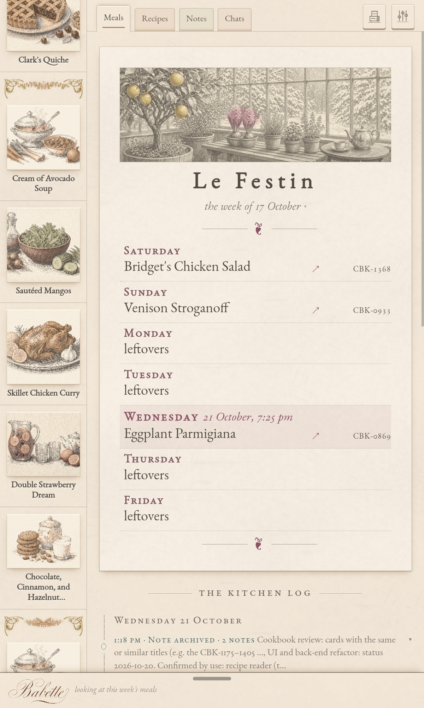
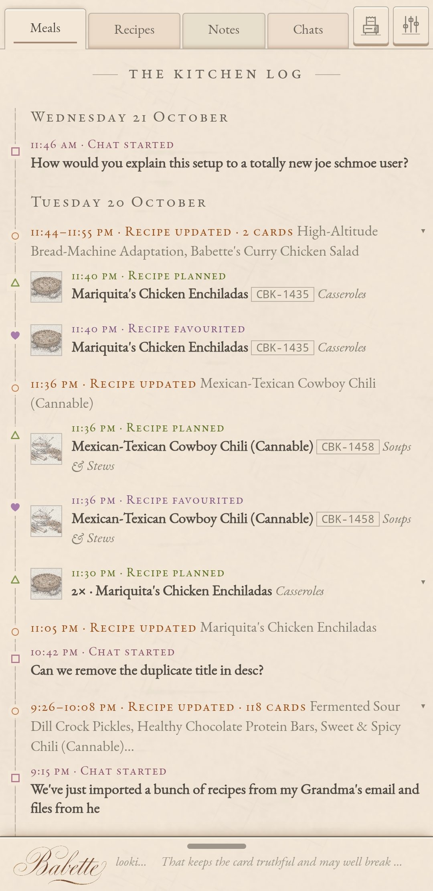
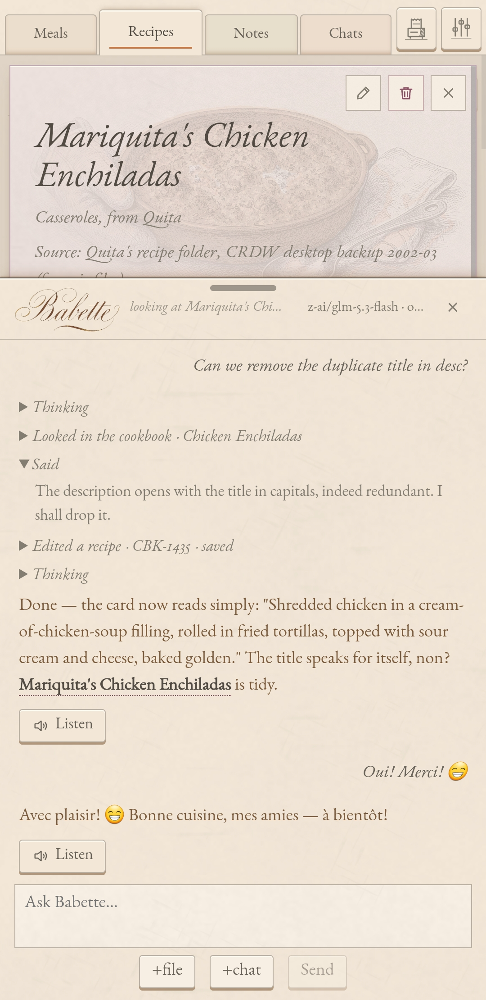

# ❦ Festin

Festin is a self-hosted recipe manager and family cookbook with a built-in AI kitchen assistant named Babette.

My grandmother left over a thousand recipes when she died, mostly on handwritten and clipped index cards that nobody could search. My own collection was scattered across notes apps, email and chats with various AI assistants. Festin manages them all in one place, safely at home, and makes curating and cooking from them again effortless. You don't have to enter or track anything by hand: just talk about your recipes or snap a photo, and Babette files it, tidies it and fills in the context.

<p>
  
  
  
</p>

## Features

- **Recipes.** Start with my multi-generational collection of over 1400 recipes, import your own, or make new ones with Babette.
- **Notes.** Flexible notes system can be used for shopping lists, inventory, to-dos, or anything else you can think of.
- **Meals.** A plan for the week, based on your preferences and recipes. Best sent to a thermal receipt printer.
- **Kitchen Log.** What got cooked and when, what was added or changed, what you asked Babette.
- **Locally Hosted.** Keeps personal information private at home, instead of scattered across multiple closed ecosystems.

## AI Integration

- **Babette.** Does the data work so you don't have to. Talk about your cooking and she adds it, cleans it up and gives it useful context, so every card ends up tidy and unique. Under the hood she's a full agentic harness with tools to edit, manage, print and integrate the entire kitchen.
- **Contextual Learning.** Keeps household tastes, restrictions and standing preferences, and cooking history (what you've made lately, favorites you haven't cooked in a while, the to-cook queue) as lasting context.
- **Working Memory.** Tracks active priorities on working notes, and carries follow-ups from one chat to the next. 
- **Flexible Ingestion.** Add recipes from photos, files, or text in chat. 
- **Easy Endpoints.** Any OpenAI-compatible model works (OpenRouter by default). Easily point to local endpoints.
- **Inbound API.** Scripts and cloud agents can easily import recipes to the cookbook. See [docs/incoming-recipes.md](docs/incoming-recipes.md).
- **Outbound API.** Send lists for shopping or coordination to cloud agents such as Grok Bot or Muse.

### Extras

Plugins enabled in Settings.

- **Thermal Printer.** Add beautiful vintage thermal printing templates for printing recipes, notes, lists, and mealplans that can be stuck on the fridge or above the stove. See [docs/print-receiver.md](docs/print-receiver.md).
- **Dinner tattva.** Ayurvedic meal planning for Babette, names each night's element at the dinner hour, from local sunrise.
- **Cloud agents.** Babette can send a list, such as a shopping list, to an outside agent. See [docs/cloud-agents.md](docs/cloud-agents.md).

## Stack

- Front end: Vite, React and Motion, in `web/`.
- Back end: Python standard library over SQLite, in `festin/`. No framework.
- Environment: a Nix flake. `nix develop` provides node, Python with pytest, and sqlite.

The app works on phones, tablets and desktops, and can be installed as an app.

## Running it

```sh
nix develop
(cd web && npm install)

# The kitchen. An empty database is created on first run.
python -m festin.server data/kitchen.db --host 127.0.0.1 --port 8879

# The app, in another shell. Vite sends /api to the kitchen.
npm run dev
```

To serve the built app from the kitchen as one process, run `npm run build`, then `python -m festin.server data/kitchen.db --web web/dist` (`FESTIN_WEB` is the same switch). In development leave `--web` off: Vite serves the front end and proxies `/api`.

Chat needs a model key. Set `OPENROUTER_API_KEY` or `FESTIN_MODEL_KEY` in the kitchen's environment, or put it in a `model.key` file (mode 0600) next to the database. Choose the model in Settings.

Everything else is in Settings: the table's name, the week's first day, the weather location, the plugins and the inbound API switch.

## Tests

```sh
pytest                      # back end
(cd web && npx vitest run)  # front end
npm run build               # must pass
```

## Licence

[MIT](LICENSE).
